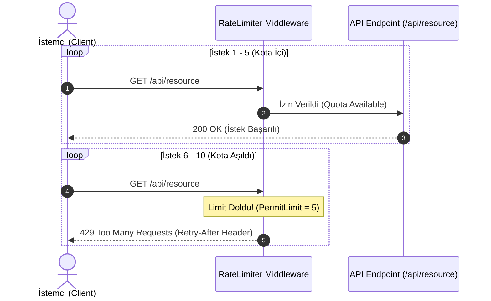

# ASP.NET Core Built-in Rate Limiting Showcase


Bu repo, **ASP.NET Core'un yerleşik (built-in) Rate Limiting middleware'ini** kullanarak harici hiçbir üçüncü parti kütüphaneye (örneğin eski `AspNetCoreRateLimit` paketine) ihtiyaç duymadan API uç noktalarını **DDoS, Brute Force ve aşırı kaynak tüketimine** karşı nasıl koruyabileceğinizi gösteren minimal ve yüksek performanslı bir örnektir.

---

## 📌 Neden Bu Proje?

Geçmişte .NET projelerinde API isteklerini sınırlandırmak için çoğunlukla harici NuGet paketleri kullanılıyordu. .NET 7+ ile birlikte `System.Threading.RateLimiting` API'si framework seviyesinde yerleşik olarak sunuldu.

* **Sıfır Harici Bağımlılık:** Tamamen standart ASP.NET Core API'leri kullanılır.
* **Yüksek Performans:** Bellek tüketimi ve CPU yükü minimize edilmiştir.
* **Standartlara Uygun:** RFC 6585 standartlarına uygun olarak `429 Too Many Requests` ve `Retry-After` HTTP yanıt başlıkları döner.

---

## 🔄 İstek Akışı (Sequence Diagram)

Aşağıdaki şemada, 10 saniyelik kayan pencere (Sliding Window) içinde gelen 10 adet eşzamanlı isteğin nasıl karşılandığı gösterilmektedir:



---

## ⚙️ Uygulanan Politika: Sliding Window (Kayan Pencere)

* **Politika Türü:** `SlidingWindowLimiter`
* **İzin Verilen İstek (PermitLimit):** 10 saniye içinde maksimum **5 istek**.
* **Kayan Pencere Segmenti (SegmentsPerWindow):** 2 (5 saniyelik 2 dilim halinde zamanı kaydırır).
* **Kuyruk Limiti (QueueLimit):** `0` (Bekletme kuyruğu olmadan, kotayı aşan istekler anında `429` ile reddedilir).

### 429 Hata Yanıtı Örneği
```json
{
  "status": 429,
  "error": "Too Many Requests",
  "message": "İstek limiti aşıldı. Lütfen daha sonra tekrar deneyiniz.",
  "retryAfterSeconds": 8,
  "timestamp": "2026-11-12T06:37:00Z"
}
```

---

## 🚀 Hızlı Başlangıç

### 1. Projeyi Klonlayın ve Çalıştırın
```bash
git clone https://github.com/EmreSlgr/aspnetcore-rate-limiting.git
cd aspnetcore-rate-limiting
dotnet run
```
API varsayılan olarak `http://localhost:5206` adresinde ayağa kalkacaktır.

### 2. Canlı Test Edin
Farklı bir terminal veya VS Code içerisinden sağlanan test betiğini çalıştırın:
```powershell
.\test-rate-limit.ps1
```

**Beklenen Konsol Çıktısı:**
```text
[1/10] Status: 200 OK - İstek Başarılı (İzin Verildi)
[2/10] Status: 200 OK - İstek Başarılı (İzin Verildi)
[3/10] Status: 200 OK - İstek Başarılı (İzin Verildi)
[4/10] Status: 200 OK - İstek Başarılı (İzin Verildi)
[5/10] Status: 200 OK - İstek Başarılı (İzin Verildi)
[6/10] Status: 429 Too Many Requests - LIMIT AŞILDI (Engellendi!) [Retry-After: 9 sn]
[7/10] Status: 429 Too Many Requests - LIMIT AŞILDI (Engellendi!) [Retry-After: 9 sn]
[8/10] Status: 429 Too Many Requests - LIMIT AŞILDI (Engellendi!) [Retry-After: 9 sn]
[9/10] Status: 429 Too Many Requests - LIMIT AŞILDI (Engellendi!) [Retry-After: 9 sn]
[10/10] Status: 429 Too Many Requests - LIMIT AŞILDI (Engellendi!) [Retry-After: 9 sn]
```

---

## 📂 Proje Yapısı
```text
aspnetcore-rate-limiting/
│
├── Program.cs             # Rate limiting konfigürasyonu ve minimal endpoint'ler
├── test-rate-limit.ps1    # Otomatik test ve demonstrasyon scripti
├── .gitignore             # Standart .NET temizleme kuralları (bin/obj/vs ignore)
└── README.md              # Dokümantasyon ve mimari diyagramı
```

---

## 👨‍💻 Geliştirici
* **Emre Salgır** - [GitHub Profilim](https://github.com/EmreSlgr)
